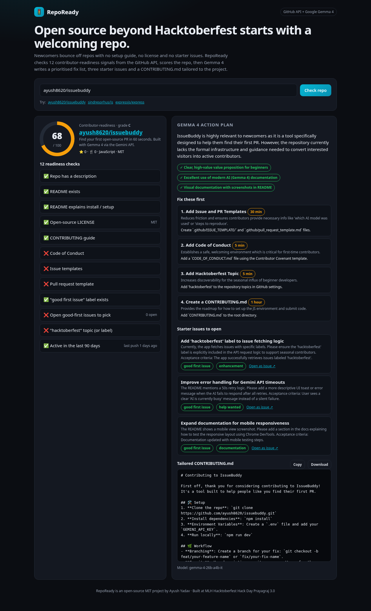

# 🚦 RepoReady

**Is your repo ready for first-time contributors?** Enter any public GitHub repo. RepoReady checks 12 contributor-readiness signals from the GitHub API and gives a 0-100 score. Then **Google Gemma 4** writes a prioritised fix list, three ready-to-open starter issues and a **CONTRIBUTING.md tailored to the project**.



## Why
"Open source beyond Hacktoberfest" only works if newcomers can actually start. Most small repos lose contributors because they have no setup guide, no license, no starter issues and no templates. RepoReady shows maintainers exactly what's missing and drafts the fixes in about 30 seconds.

## Prize track
**Best Open-Source AI Project** (Hacktoberfest 2026 × MLH). It's an MIT-licensed tool where open-weight Gemma 4 does the core work of writing the plan, issues and CONTRIBUTING.md. It also fits **Best Use of Gemma 4** and the Hack Day's open-source and dev-tooling theme.

## The 12 checks
Description · README · README setup/usage section · LICENSE · CONTRIBUTING · Code of Conduct · issue templates · PR template · "good first issue" label · open good-first issues · `hacktoberfest` topic/label · pushed in the last 90 days. The checks are weighted and scored deterministically, with no AI involved, so the score is reproducible.

## Gemma 4 output
- A summary and strengths.
- Up to 5 fixes, each with why it matters, how to do it and the effort.
- 3 starter issues, each with a one-click **"Open as issue"** link that pre-fills title, body and labels on GitHub.
- A tailored `CONTRIBUTING.md` (copy or download).

If Gemma is busy, you still get the score and the checklist.

## Run locally
```bash
git clone https://github.com/ayush8620/repoready && cd repoready
cp .env.example .env
export GEMINI_API_KEY=your_key      # free: https://aistudio.google.com/apikey
export GITHUB_TOKEN=optional_token  # optional, raises GitHub limit 60 -> 5000 req/h
node server.js                      # http://localhost:3000 (Node 18+, no npm install)
```
Deep link: `http://localhost:3000/?repo=owner/name`. API: `POST /api/audit {"repo":"owner/name"}`.

## Deploy (free)
Import the repo on [Vercel](https://vercel.com/new) (preset "Other"), set `GEMINI_API_KEY` (and optionally `GITHUB_TOKEN`), and deploy.

## Tech
- Vanilla JS, no build step, zero dependencies.
- GitHub REST API: repo, community profile, README, labels and issues, which is 5 requests per audit.
- **Google Gemma 4** via the Gemini API (`gemma-4-31b-it` and `gemma-4-26b-a4b-it` in parallel with retries).

| Path | What |
|---|---|
| `lib/audit.js` | GitHub data collection + scoring |
| `api/audit.js` | API: checklist + Gemma 4 plan |
| `api/_gemma.js` | Gemma 4 client |
| `index.html`, `style.css`, `app.js` | UI |
| `server.js` | local dev server |

## License
[MIT](LICENSE) © 2026 Ayush Yadav. Built at MLH Hacktoberfest Hack Day Prayagraj × WikiClub Tech UIT (Edition 3.0).
